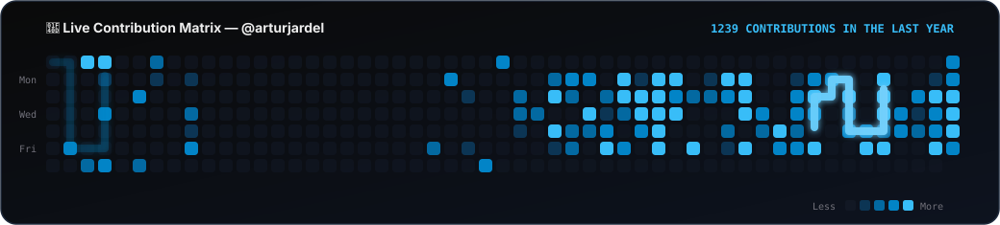

  <!-- Custom Theme-Aligned SVG Hero Banner (#0a0a0a + #38bdf8 Sky Neon) -->
  

   

  <!-- Dynamic Typing Headline -->
  

   

  <!-- Quick Links & Contact Pills -->
  

    
    
    
  

---

### ⚡ Engineering Snapshot

  

---

### 🚀 Flagship Production Systems & Research

| Project / System | Architecture & Impact | Core Stack | Live / Reference |
| :--- | :--- | :--- | :---: |
| **oHub** *Multi-Tenant AI Customer Service & CRM SaaS* | Commercial operations platform built for **OQV** centralizing WhatsApp channels with strict multi-operation isolation (`client + phone + agent`), hybrid AI + human handoff inbox, configurable Kanban CRM, Google Calendar sync, and AI agent governance. | `React 19` · `TypeScript` · `Supabase (RLS/RPC)` · `n8n` · `Meta & Evolution API` | [🌐 Live SaaS](https://ohub.organizaquevende.com) |
| **LoteVerse** *3D Real Estate & Land Visualization* | Interactive spatial platform built for the **ExpoVerse Web3 Challenge (RESTIC 29)** enabling buyers and developers to explore land plots and real estate developments inside an interactive 3D map. | `React` · `TypeScript` · `Unity WebGL` · `Tailwind CSS` · `Vite` | [🌐 Live 3D App](https://loteverse.arturjardel.com.br/) [💻 Repository](https://github.com/arturjardel/loteverse) |
| **OpenIoHT** *Internet of Health Things Framework* | B.S. Thesis research framework at **GREat / UFC** for high-frequency biomechanical time-series ingestion, semantic DTO validation, raw stream preservation, and automated Kaggle dataset curation (*Timed Up and Go* clinical protocol). | `NestJS` · `TypeScript` · `InfluxDB` · `Docker` · `React Native` | 🎓 *UFC Research* |
| **Simula IA** *Generative AI Simulation Platform* | Web platform and intelligent backend API utilizing Generative AI to generate, manage, and evaluate interactive exams and simulations across multiple domains. | `Next.js` · `TypeScript` · `Node.js` · `Generative AI` · `PostgreSQL` | [🌐 Live App](https://simula-ia.vercel.app/) [💻 Backend Repo](https://github.com/arturjardel/simula-ia-back) |
| **Loading Jr. & Digital Voting** *Institutional Web & Electronic Urn* | Official institutional platform and secure online voting system built while serving as **Project Director & Back-End Coordinator** at Loading Desenvolvimento Jr. (UFC). | `Next.js` · `React` · `TypeScript` · `Tailwind CSS` · `Node.js` | [🌐 Loading Jr.](https://loadingjr.com.br/) [🗳️ Electronic Urn](https://urna.loadingjr.com.br/) |

---

### 🛠️ Tech Stack & Ecosystem

| Layer | Technologies & Tools |
| :--- | :--- |
| **Frontend & Mobile** |  |
| **Backend, Data & DevOps** |  |
| **AI, Automation & Data Science** |       |

---

### 📊 GitHub Telemetry & Activity

  
  

  
  

---

### 🐍 Contribution Grid Snake

  

---

  Designed & engineered by <a href="https://arturjardel.com.br"><b>Artur Jardel</b></a> • Fortaleza / Sobral, Brazil 🇧🇷

