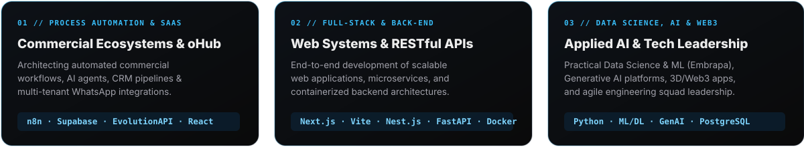

  <!-- Custom Theme-Aligned SVG Hero Banner (#0a0a0a + #38bdf8 Sky Neon) -->
  

   

  <!-- Dynamic Typing Headline -->
  

   

  <!-- Quick Links & Contact Pills -->
  

    &nbsp;
    &nbsp;
    
  

---

### ⚡ Core Areas & Current Focus

  

- **Process Automation & Systems Integration (`Organiza Que Vende`):** Modeling end-to-end commercial and operational workflows, integrating **n8n**, **Supabase (PostgreSQL)**, **EvolutionAPI**, and **Meta Cloud API** into the multi-tenant **oHub** SaaS platform.
- **Full-Stack & Back-End Engineering:** Practical experience architecting web applications and RESTful APIs using **Next.js**, **React**, **Vite**, **Nest.js**, **Node.js**, **TypeScript**, and **Python** (**FastAPI**, **Flask**, **Django**) with **Docker**.
- **Technical Leadership & Academic Background:** Computer Engineering undergraduate at **UFC (Sobral)**, International Virtual Academic Exchange at **Instituto Politécnico de Setúbal (Portugal)**, former **Project Director** & **Back-End Project Coordinator** at **Loading Desenvolvimento Jr.**, and Data Science fellow at **Capacita Brasil / Embrapa**.

---

### 🚀 Featured Projects in Production

| Project | Description & Value Delivered | Stack | Live / Code |
| :--- | :--- | :--- | :---: |
| **oHub** *AI Customer Service, CRM & WhatsApp SaaS* | Multi-tenant SaaS platform developed for **Organiza Que Vende (OQV)** that centralizes commercial WhatsApp operations: hybrid AI + human handoff inbox, configurable Kanban CRM, Google Calendar sync, and AI agent governance. | `React` · `TypeScript` · `Vite` · `Supabase` · `n8n` · `EvolutionAPI` | [🌐 Live Platform](https://ohub.organizaquevende.com) |
| **LoteVerse** *3D Real Estate & Land Plot Visualization* | Interactive real estate platform built during the **Web 3.0 & Metaverse Residency (RESTIC 29 / iRede)** allowing brokers and buyers to explore land plots directly on an interactive 3D map. | `React` · `TypeScript` · `Vite` · `Unity WebGL` · `Tailwind CSS` | [🌐 Live App](https://loteverse.arturjardel.com.br/) [💻 Repository](https://github.com/arturjardel/loteverse) |
| **Simula IA** *AI-Powered Interactive Simulations* | Web platform and REST API that leverages Generative AI to create, manage, and evaluate interactive simulations across multiple domains. | `Next.js` · `TypeScript` · `Node.js` · `Generative AI` · `PostgreSQL` | [🌐 Live App](https://simula-ia.vercel.app/) [💻 Backend Repo](https://github.com/arturjardel/simula-ia-back) |
| **Account & Elevasoft** *Financial AI & Enterprise Management* | AI-integrated financial automation platform (**Account**) and enterprise management system (**Elevasoft**) designed to optimize internal business workflows. | `Next.js` · `React` · `TypeScript` · `Python` · `FastAPI` | [🌐 Account](https://accont-five.vercel.app/login) [🌐 Elevasoft](https://elevaged.vercel.app/) |
| **Loading Jr. & Electronic Urn** *Institutional Portal & Online Voting* | Modern institutional website and secure electronic voting platform delivered for **Loading Desenvolvimento Jr.** | `Next.js` · `React` · `TypeScript` · `Tailwind CSS` · `Node.js` | [🌐 Loading Jr.](https://loadingjr.com.br/) [🗳️ Voting System](https://urna.loadingjr.com.br/) |
| **Academic Search & Acaraú Valley** *Research Tool & Startup Ecosystem Portal* | Dedicated academic journal search engine (**Buscador Acadêmico**) and regional startup ecosystem portal (**Acaraú Valley**). | `Next.js` · `React` · `TypeScript` · `Tailwind CSS` | [🌐 Academic Search](https://buscador-academico.vercel.app/) [🌐 Acaraú Valley](https://site-acarau-valley-beta.vercel.app/) |

---

### 🛠️ Tech Stack & Tools

| Category | Technologies |
| :--- | :--- |
| **Languages** |  |
| **Full-Stack & Frameworks** |  |
| **Automation, Data & DevOps** |  |
| **Automation & Applied AI** |      |

---

### 📊 GitHub Telemetry & Activity

  
  

  
  

---

### 🐍 Contribution Grid Snake

  

---

  Designed & engineered by <a href="https://arturjardel.com.br"><b>Artur Jardel</b></a> • Sobral, Ceará — Brazil 🇧🇷

